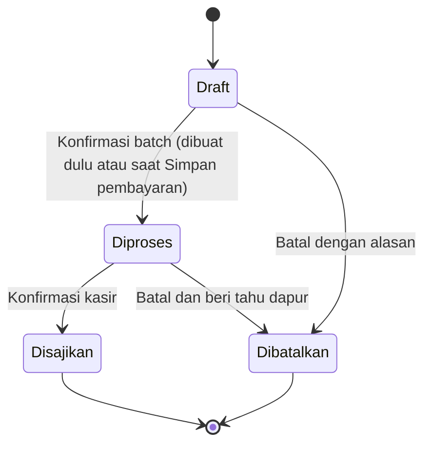

# 04 — Orders and dine-in

**Pesanan aktif D-78:** workspace Aktif/Tersimpan dan detail bersama mengikuti bagian D-78; default Lunas/tabel/halaman detail tablet lama diganti. Kasir D-76/D-77 dan aturan integritas tetap. [Review](../berrie-site/REVIEW-PESANAN-D78.md).

**Acuan Kasir terkini D-76 · 31 Oktober 2026:** tambah langsung menu sederhana/Urungkan, Favorit berurutan tetap, Channel dan default penyajian di kepala pesanan, serta Mulai bertugas. D-76 mendahului kewajiban modal/Tambahkan untuk semua menu dan penyajian hanya di modal pada D-71/72. Aturan uang, stok, izin, commit, cetak dan pemulihan tetap. [Bukti dan batas lokal](../berrie-site/REVIEW-KASIR-D76.md).

## Identitas pesanan

Order memiliki UUID tetap, nomor tampilan, default penyajian `dine_in`/`takeaway` untuk item berikutnya, sesi kas, no. antrean/nama wajib saat simpan/proses/bayar, catatan dan referensi order asal opsional. Default Bungkus. D-72: pemilih penyajian hanya pada modal item, Makan di tempat kiri/Bungkus kanan dan default Bungkus. Card Pesanan baru tidak mempunyai pemilih Item berikutnya. Keranjang menampilkan hasil per item. Setiap baris/unit menyimpan penyajiannya sendiri; satu order boleh campuran tanpa split bill. Menu sama yang sebagian makan di tempat dan sebagian dibungkus menjadi dua baris berqty dengan harga/topping yang sama, ID unit berbeda dan satu tagihan. Ringkasan/tiket menyebut penyajian setiap baris. Mengubah default tidak mengubah item yang sudah dipilih. Penyajian item draft belum lunas boleh diedit; setelah masuk batch atau lunas snapshotnya immutable. Identitas wajib boleh diubah sebelum lunas dengan audit; sesudah ada batch, beri tahu dapur langsung. Tidak ada manajemen meja.

Nomor tampilan: `YYMMDD-E{epoch}-{sequence}`, misalnya `261006-E1-0042`. Tanggal memakai zona toko saat order dibuat, sequence naik per tanggal dan epoch, minimal empat digit tanpa batas reset 9999. Epoch bertambah saat aktivasi/pergantian kasir. Nomor dibagikan saat draft pertama tersimpan dan tidak digunakan ulang setelah batal. UUID menjadi identitas teknis; nomor tetap aman terhadap duplikasi restore lewat epoch baru.

## Unit, baris dan batch

Baris menyimpan snapshot SKU, nama, harga, topping dan catatan; qty menunjukkan banyak unit identik. Setiap unit punya identitas internal stabil untuk alokasi uang, penyajian parsial, pembatalan dan refund. UI tetap menampilkan baris berqty, bukan memaksa satu baris per unit. Catatan item langsung terlihat sejak draft dengan label Catatan, membungkus utuh agar kasir dapat membacakan kembali pesanan sebelum bayar; tetap ikut snapshot/tiket dapur.

Batch berisi referensi unit draft yang dikonfirmasi bersama. Nomor batch mulai 1. Batch ≥2 berjudul **TAMBAHAN**, hanya memuat unit baru. Menambah draft tidak mengubah isi batch sebelumnya.

Diagram berlaku per unit. Refund adalah status keuangan terpisah; unit disajikan tidak mundur menjadi dibatalkan. Unit dibatalkan tidak bisa diproses atau disajikan kembali.

## Status agregat order

Tampilkan badge kerja, badge bayar dan hitungan pekerjaan terpisah. Jangan memaksakan semuanya menjadi satu status.

| Kondisi unit tidak dibatalkan | Badge kerja |
| --- | --- |
| Semua masih draft | Disimpan dulu · Belum diminta dibuat |
| Ada unit diproses yang belum disajikan | Sudah diminta dibuat · Belum disajikan / diserahkan |
| Ada unit disajikan dan draft tambahan, tanpa unit sedang diproses | Tambahan belum diminta dibuat |
| Semua disajikan | Disajikan / Diserahkan |
| Tidak ada unit tersisa | Dibatalkan |

Jika beberapa kondisi bercampur, tampilkan rincian `2 belum diminta dibuat · 3 belum disajikan / diserahkan · 1 sudah disajikan / diserahkan`. Tambahan tidak tersembunyi oleh badge Disajikan dari batch lama.

Order aktif jika ada unit draft/diproses, tagihan belum selesai, atau kewajiban refund belum dipenuhi. Order selesai jika semua unit terminal dan keuangan selesai: lunas/penyelesaian Rp0/tagihan platform terverifikasi untuk unit tersisa, atau batal penuh belum pernah dibayar, atau refund kewajiban batal sudah selesai. Refund sukarela atas order selesai dapat dilakukan kemudian tanpa membuka pekerjaan dapur.

## Kontrak Minta dibuat

1. Perangkat mempunyai hak mutasi dan sesi kas masih terbuka. Setelah izin/langganan habis, hanya unit yang sudah ada saat batas habis dapat diselesaikan.
2. Ambil seluruh unit draft tidak dibatalkan pada order; bila kosong, jangan membuat batch kosong.
3. Validasi ketersediaan menu, varian, topping dan kebutuhan SKU agregat. Paid draft data lama/pemulihan tetap menjalani validasi ini; bayar dulu baru mengonfirmasi batch bersama settlement.
4. Dalam satu transaksi lokal: cek versi order/saldo, buat batch, pindahkan unit ke diproses, tulis delta stok dan audit, tulis outbox dan print job logis.
5. Setelah commit berhasil, tampilkan Sudah diminta dibuat dan buka upaya cetak tiket. Jika commit gagal, tidak boleh mencetak atau menampilkan sukses.
6. Klik ganda/retry ID operasi yang sama mengembalikan batch yang sama. Permintaan baru tanpa draft tidak mengurangi stok lagi.

Pesanan yang sudah lunas masih dapat diproses/disajikan, tetapi tidak dapat ditambah atau diubah harga/isinya. Pesanan belum bayar boleh mendapat draft tambahan kapan pun sebelum pembayaran, termasuk setelah batch sebelumnya disajikan.

## Bayar dan konfirmasi pembuatan

Pada **Bayar**, membuka/menutup form tidak mengubah pembayaran, batch, stok atau antrean pembuatan. **Simpan pembayaran** memvalidasi seluruh input/stock/revisi lalu menyimpan settlement/payment serta konfirmasi semua unit draft, batch, ledger stok, audit, outbox dan print job bersama dalam satu transaksi. Jika ada tambahan draft di atas batch lama, hanya unit baru yang masuk batch tambahan. Jika tidak ada draft, bayar hanya menyimpan settlement/payment tanpa batch atau debit baru. Gagal commit seluruhnya rollback; uang eksternal yang sudah diterima tetap perlu diperiksa, jangan minta pelanggan membayar ulang. D-72: tiket batch baru otomatis dicoba setelah commit, diikuti struk pelanggan pada settlement; tanpa draft baru hanya pelanggan. Bayar nanti hanya dapur. Lunas tidak berarti disajikan. Sesudah pembayaran terkonfirmasi, Kasir menyiapkan keranjang kosong untuk pelanggan berikutnya; transaksi/tiket asal tetap tersimpan dan pemulihan cetak tidak memakai order kosong itu. Penyajian dilanjutkan dari Pesanan → detail, tanpa auto-disajikan. Kegagalan atau hasil belum diketahui mempertahankan input/order sampai hasil operasi yang sama diperiksa.

State internal `processed` berarti permintaan pembuatan dikonfirmasi kasir, bukan bukti dapur sedang memasak. UI menggunakan **Sudah diminta dibuat**, **Belum disajikan / diserahkan**, **Disimpan dulu**, dan **Belum bayar** dengan hitungan per keadaan. Data lama/pemulihan yang lunas tetapi masih draft tetap bisa dikonfirmasi lewat **Minta dibuat**.

## Edit dan pembatalan

- D-72: detail pesanan yang hanya disimpan menyediakan **Edit pesanan** ke Kasir untuk tambah/hapus menu, qty, pilihan, penyajian dan catatan. Perubahan kerja dipertahankan ketika simpan gagal; commit memakai UUID/nomor/revisi asal. Simpan dulu tidak membuat batch, mencetak atau mendebit stok. Unit confirmed/lunas tidak ditimpa lewat alur ini.
- Draft belum bayar dapat diubah qty, pilihan dan catatan. Menghapus unit draft tidak mengembalikan stok.
- Unit processed immutable untuk SKU/qty/harga/topping/catatan/penyajian. Koreksi pesanan dilakukan dengan pembatalan unit dan menambah unit baru pada order belum bayar; tidak menimpa tiket lama.
- Pembatalan processed membutuhkan alasan dan checkbox **Dapur sudah diberi tahu**. Dapur tetap menerima komunikasi manusia; cetak pemberitahuan batal opsional memakai printer kasir.
- Untuk qty parsial, pilih jumlah unit yang dibatalkan; paling banyak jumlah unit belum disajikan/belum dibatalkan. Stok kembali hanya bila secara fisik layak dan owner memilihnya.
- Unit yang sudah disajikan tidak dibatalkan operasional. Gunakan refund/retur bila relevan, dengan histori penyajian tetap ada.
- Unit paid yang dibatalkan menimbulkan refund due sebesar alokasi asli. Sampai uang dikembalikan dan dicatat, order tetap aktif dan menghalangi tutup kas.
- Pembatalan belum bayar mengubah tagihan; pembatalan setelah bayar tidak mengubah settlement asli. Refund menjadi dokumen terpisah.

## Penyajian

Kasir memilih batch/baris dan qty yang benar-benar disajikan/diserahkan. Aksi **Semua sudah disajikan** hanya berlaku unit processed, bukan draft. Salah tanda disajikan dapat dikoreksi melalui event koreksi beralasan ke processed, selama sesi asal masih terbuka; pembayaran/stok tidak berubah. Sesi tertutup tidak diedit.

## Contoh tambahan

Order 0042: batch 1 berisi dua kopi, sudah disajikan, belum bayar. Tambah satu teh → badge Tambahan belum diminta dibuat. Konfirmasi pembuatan → batch 2 **TAMBAHAN**, stok teh turun satu. Pelanggan bayar tiga minuman → Lunas tetapi masih aktif. Setelah teh disajikan, baru order selesai.

## Pesanan platform manual dan pencatatan terlambat

Order menyimpan channel, identitas akun outlet platform, ID pesanan eksternal wajib untuk channel platform, actor pencatat dan referensi bukti/catatan manual. ID ditrim di tepi tanpa mengubah huruf atau tanda internal; keunikan dalam toko + channel + akun outlet + ID eksternal dipertahankan setelah batal/arsip/restore. Retry membuka order yang sama; pesanan pengganti ditautkan ke sumber, bukan menerima duplikat tanpa jejak. Channel **Toko** tidak memerlukan ID platform. Channel berbeda dari metode pembayaran dan penyajian; online tidak otomatis berarti uang diterima atau makanan diserahkan.

Alur normal: lihat pesanan di aplikasi merchant → catat channel/ID dan item sesuai SKU → **Minta dibuat** atau **Catat tagihan platform** (file 05) → satu batch/debit stok → serahkan ke kurir/pelanggan → catat status penyerahan. Berrie tidak menerima/menolak pesanan di platform; status eksternal dicek dan diperbarui manusia. Pelanggan/kurir membayar langsung ke toko hanya dicatat sebagai Payment nyata bila memang demikian, bukan otomatis karena order berchannel platform.

**Sudah dibuat sebelum dicatat** adalah pilihan beralasan yang tunduk izin pencatatan terlambat: simpan waktu kejadian dan waktu pencatatan, konfirmasi batch/debit stok tepat sekali; tandai diserahkan hanya bila benar-benar telah diserahkan. Jangan membuat tiket dapur otomatis; cetakan manual bertanda **CATATAN SUSULAN — JANGAN DIBUAT LAGI**. Ini hanya untuk pesanan yang belum tercatat dan belum pernah mendebit ledger Berrie; ID eksternal diperiksa lebih dahulu. Jika stok sudah dikoreksi sebelumnya, owner menelusuri referensi dan merekonsiliasi koreksi itu secara berjejak sebelum pencatatan, tanpa debit kedua atau stok fiktif. Kejadian sesi tertutup dicatat sebagai penyesuaian terlambat di sesi kini dengan waktu asal, tidak menulis ulang sesi lama.

Permintaan persetujuan tidak mengubah order, stok, pembayaran atau dapur. Setelah disetujui, kasir masih harus menjalankan aksi yang sama pada revisi yang sama. Unit/nominal berubah, sesi tutup atau perangkat berganti membatalkan kelayakan eksekusi. Batal/refund platform tetap mengecek kejadian sebenarnya di aplikasi merchant; pembatalan tidak otomatis mengembalikan stok atau dana.

Untuk channel platform, aturan penguncian setelah lunas juga berlaku setelah tagihan platform difinalisasi: tambahan menjadi order baru, tidak mengubah snapshot tagihan. Status belum settlement tetap Belum bayar atau Belum diverifikasi; tagihan platform terverifikasi bukan unpaid pelanggan. Pembalikan yang belum dikonfirmasi tetap kewajiban; saldo pencairan saja tidak membuat order aktif kembali.

## Pilihan penyajian — D-44

Pemilih item hanya **Bungkus** dan **Makan di tempat**. Tidak ada opsi **Campuran**. Kemampuan satu tagihan campuran tetap dipertahankan melalui dua baris berbeda, termasuk SKU yang sama; default hanya item berikutnya. Identitas unit/batch/refund lama tidak berubah. Istilah tiket/batch dalam model domain tetap sah; label utama cetak di UI memakai Struk/Untuk dapur/Untuk pelanggan sesuai file 09.

## Pesanan aktif dan Riwayat — D-54

Riwayat hanya order tersimpan yang settlement, seluruh unit disajikan/dibatalkan, tanpa draft/requested/refund due. Pesanan lunas belum disajikan tetap aktif. Refund selesai setelah uang dikembalikan tetap tampil pada histori ketika pekerjaan seluruhnya selesai; pembatalan/refund tidak menghapus order atau stok otomatis. Batal seluruhnya sebelum bayar tetap tersimpan dalam audit/data sumber tetapi tidak masuk Riwayat transaksi selesai.

## Daftar dan detail — D-78 (menggantikan UI D-55)

Pesanan adalah workspace pekerjaan aktif, dengan kelompok **Aktif** (confirmed dengan pekerjaan/tagihan/refund/kewajiban menurut domain) dan **Tersimpan** (draft disimpan, belum pernah dikonfirmasi dan belum settlement). Confirmed dengan tambahan draft tetap Aktif. Keduanya tidak tumpang tindih; badge navigasi menjumlah keduanya, badge kelompok sebelum search/filter. Definisi active/completed dan kewajiban penutupan kas tidak berubah. Riwayat tetap mengikuti syarat di atas.

Masuk dari navigasi utama memilih Aktif; Pengerjaan dan Pembayaran awal Semua. Pengerjaan Semua/Belum disajikan/Sudah disajikan dan Pembayaran Semua/Belum bayar/Lunas bekerja AND. Belum disajikan = ada requested; Sudah disajikan = ada unit confirmed nonbatal dan semuanya served. Draft/cancelled tidak dihitung. Klasifikasi bayar dari domain settlement, bukan penyajian. Tersimpan tanpa kedua filter. Search nomor/identitas/ID platform hanya kelompok terpilih; ganti kelompok mengosongkan search/filter. Bedakan kosong kelompok dan hasil tidak cocok, dengan Reset pencarian dan filter untuk hasil kosong.

Urut Aktif: ada requested dahulu, menurut waktu konfirmasi batch tertua yang masih mempunyai requested; lalu aktif tanpa requested menurut konfirmasi pertama. Timestamp valid mendahului data tanpa timestamp dalam kelompok urutannya; ID pembeda akhir. Jangan memakai created/payment sebagai pengganti. Jika timestamp suatu batch yang diperlukan hilang/invalid, waktu tidak diketahui (termasuk ketika waktu batch lain valid); tampil Waktu tidak tersedia. Waktu tunggu memakai clock aktual yang dapat dikendalikan tes, tanpa ambang terlambat. Tersimpan menurut waktu simpan draft terakhir, terbaru dahulu; timestamp hilang di akhir.

Entri menampilkan nomor/identitas, channel/ID platform, maksimal dua baris item dikelompokkan dan +N baris lainnya, served/(served+requested), status bayar, sisa tagihan dari operasi domain, refund/kewajiban terpisah dan waktu tunggu bila requested. Tersimpan hanya identitas/channel/ringkasan/total draft/waktu simpan. Ketuk seluruh entri membuka detail, tanpa kolom Buka rincian. Nomor batch dan penyajian per item terlihat pada detail. Pemilihan qty penyajian mulai kosong, hanya requested, tombol disabled tanpa pilihan dan Pilih semua yang belum disajikan eksplisit. Pembayaran dan penyajian tidak saling mengeksekusi; draft/cancelled tidak eligible penyajian. Nilai refund tetap alokasi asli.

## Racikan dan stok asal — D-58

Snapshot unit menyimpan pilihan racikan Es/Gula/custom dan ID grup stok asal. Unit berbeda racikan tidak digabung meskipun SKU/harga/topping sama. Snapshot dan tiket mempertahankan racikan saat katalog berubah; tidak menjadi harga atau stock return terpisah. Konfirmasi agregasi stok per grup melintasi SKU rasa/ukuran; return unit eligible kembali ke grup asal sekali. Rekap online D-59 bukan pesanan/batch dapur dan tidak mencetak tiket masak.

## Draft cepat dan default penyajian — D-76

`Order.serving` berfungsi sebagai default **hanya item berikutnya**, awal Bungkus untuk setiap pesanan baru termasuk lanjutan pesanan lunas. `Unit.serving` tetap sumber kebenaran detail/cetakan. Mengubah default tidak menyentuh item lama. Tambah langsung membaca default saat ketuk; editor baru diinisialisasi dari default lalu boleh berbeda sebelum Tambahkan ke pesanan. Edit penyajian draft per baris tidak mengubah default atau baris lain; koreksi confirmed tetap aturan/izin sebelumnya.

Tambah langsung memasukkan satu ID unit draft. Baris tampilan digabung hanya bila SKU, penyajian, pilihan/racikan/topping, catatan, status/batch dan snapshot harga/channel/promo sama. Unit confirmed tidak digabung dengan draft atau diubah. Qty draft1–999 per baris tetap; perubahan draft tidak mendebit stok.

Feedback menyimpan identitas order dan satu ID unit yang baru ditambah, bukan perintah hapus seluruh baris. Urungkan menghapus hanya penambahan yang diwakili feedback, sekali. Penambahan berikutnya mengganti kesempatan lama; mengedit item menghentikan kesempatan lama. Commit terkait berhasil menghapus kesempatan; unit confirmed atau order lunas tidak dapat diurungkan. Busy/unknown mengunci aksi; gagal mempertahankan input dan operasi yang sama. Simpan dulu tetap tanpa debit/cetak; konfirmasi dan settlement tetap persis sekali.
